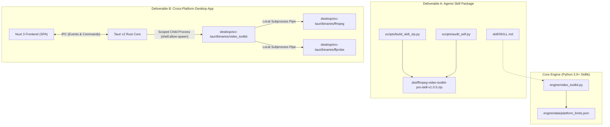
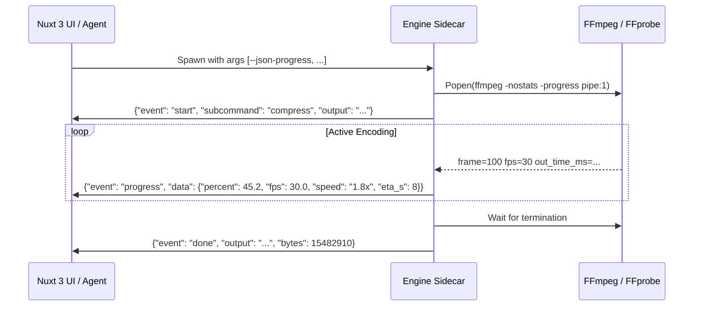

# FFmpeg Video Toolkit Pro — System Architecture

This document describes the high-level system architecture, IPC bridges, streaming event schemas, safety boundaries, and design principles of **FFmpeg Video Toolkit Pro**.

---

## 1. High-Level Architecture

FFmpeg Video Toolkit Pro delivers two distinct commercial products powered by a single core engine:
1. **Deliverable A (Agensi Agent Skill Package)**: An AI agent skill adhering to the Agensi standard format, executing the engine directly via standard command-line tools without network access or third-party package dependencies.
2. **Deliverable B (Desktop Application)**: A native, cross-platform desktop application built with Tauri v2 and Nuxt 3 (TypeScript strict), which embeds the compiled engine and pinned FFmpeg/FFprobe binaries as sandboxed sidecars.



---

## 2. Component Breakdown

### 2.1 The Core Engine (`engine/video_toolkit.py`)
* **Runtime**: Python 3.9+ Standard Library only. Zero pip dependencies (`argparse`, `subprocess`, `json`, `sys`, `os`, `re`, `pathlib`, `tempfile`, `shutil`, `signal`, `math`, `time`).
* **Subcommands (11 Tools)**:
  1. `compress`: True 2-pass libx264 compression with platform size limits and bppf quality floor protection.
  2. `trim-silence`: Detects silence with `silencedetect` and stitches keep-segments using `-filter_complex_script`.
  3. `shorts`: Converts 16:9 landscape to 9:16 vertical (1080x1920) via crop or blurred background.
  4. `convert`: Batch or single-file standardizer to H.264/AAC with stream-copy optimization.
  5. `extract-audio`: High-fidelity WAV, FLAC, or VBR/CBR MP3 extraction.
  6. `cut`: Stream-copy fast cuts or `--precise` frame-accurate re-encoded cuts.
  7. `merge`: Codec-verified concat demuxer join with POSIX path escaping and `--reencode` fallback.
  8. `gif`: Two-pass `palettegen` / `paletteuse` animated GIFs or modern animated WebP.
  9. `speed`: Wide-range playback speed (0.25x - 4.0x) using `setpts` and chained `atempo` filters.
  10. `strip-meta`: Complete privacy sanitization (EXIF, GPS, chapters, metadata tags).
  11. `thumbs`: High-resolution frame extraction or tiled contact sheets (`tile` filter).
* **Global Options**: `--dry-run`, `--overwrite`, `--json-progress`, `--ffmpeg`, `--ffprobe`, `--quiet`, `--verbose`, `--check`.

### 2.2 IPC & Event Streaming Model
When executed with `--json-progress`, the engine emits single-line JSON objects to standard output (`stdout`), while streaming FFmpeg banner diagnostics to standard error (`stderr`).



---

## 3. JSON Progress Event Specification

Every event line is a JSON object with a mandatory `event` field:

```typescript
export interface ProgressEvent {
  event: 'start' | 'progress' | 'warning' | 'done' | 'error'
  subcommand?: string
  input?: string
  output?: string
  data?: {
    percent: number       // 0.0 to 100.0 (combined across passes for 2-pass)
    fps?: number          // Current encoding speed in frames per second
    speed?: string        // Relative encoding speed (e.g. "2.1x")
    eta_s?: number        // Estimated remaining time in seconds
    pass?: number         // Active pass index (1 or 2)
  }
  message?: string        // Warning or error description
  code?: number           // Numeric exit code (on error)
  bytes?: number          // Final output file size in bytes (on done)
  timestamp?: number      // Epoch millisecond timestamp
}
```

### Event Lifecycle:
1. `start`: Emitted immediately upon resolving inputs and starting the pipeline.
2. `progress`: Emitted continuously as new frames are processed by FFmpeg.
3. `warning`: Emitted when non-fatal discrepancies occur (e.g. metadata tags persisting, container overhead adjustment).
4. `done`: Emitted upon successful completion and verification of the output file.
5. `error`: Emitted when execution fails (e.g. bitrate too low, missing stream, parameter mismatch).

---

## 4. Exit Code Reference

| Exit Code | Identifier | Description |
|---|---|---|
| `0` | `SUCCESS` | Operation completed successfully and output was verified. |
| `1` | `GENERAL_ERROR` | Unhandled runtime exception or FFmpeg pipeline failure. |
| `2` | `ARGUMENT_ERROR` | Invalid CLI syntax, out-of-range parameters, or missing required flags. |
| `3` | `MISSING_DEPENDENCY` | Neither `ffmpeg` nor `ffprobe` could be found on PATH or via explicit flags. |
| `4` | `VERIFICATION_ERROR` | File verification failed (output size exceeded target limit, or destination exists without `--overwrite`). |
| `5` | `STREAM_ERROR` | Media stream format error (e.g. missing audio stream for silence detection). |
| `6` | `CANCELLED` | Execution interrupted and cleanly terminated by `SIGINT` / `SIGTERM`. |

---

## 5. Security & Isolation Architecture

1. **Subprocess Isolation**:
   - `shell=False` is enforced unconditionally on every subprocess invocation.
   - Command arguments are strictly passed as typed lists, preventing command injection or escaping vulnerabilities.
   - Paths are resolved to canonical absolute paths (`Path.resolve()`).
2. **Offline-by-Default (Zero Network)**:
   - The engine performs zero network requests or socket operations.
   - The desktop app uses a strict Content Security Policy (`default-src 'self'`) blocking all external domains, inline remote scripts, and telemetry.
3. **Static Security Audit**:
   - `scripts/audit_self.py` verifies through Python AST static analysis that the codebase contains no `eval()`, `exec()`, `urllib`, `requests`, `socket`, `ftplib`, or dynamic imports.
4. **Tauri Scoped Capabilities**:
   - Tauri v2 capability configuration (`capabilities/default.json`) restricts binary execution exclusively to the staged sidecar binaries (`binaries/video_toolkit`, `binaries/ffmpeg`, `binaries/ffprobe`). Arbitrary system command execution is prohibited.

---

## 6. Compression Bitrate & Quality Math

For hard file size compression (`compress`), the engine calculates the allowable video bitrate using:

$$\text{effective\_bytes} = \text{target\_bytes} \times (1 - \text{margin})$$

where $\text{margin} = 0.05$ (5% container muxing overhead).

$$\text{video\_bitrate\_bps} = \frac{\text{effective\_bytes} \times 8}{\text{duration\_seconds}} - \text{audio\_bitrate\_bps}$$

### Bits-Per-Pixel-Per-Frame (bppf) Quality Floor:

$$\text{bppf} = \frac{\text{video\_bitrate\_bps}}{\text{width} \times \text{height} \times \text{fps}}$$

* If $\text{bppf} < 0.04$ or $\text{video\_bitrate\_bps} < 48\text{ kbps}$, encoding is aborted immediately with exit code `2`.
* The engine provides an explicit recommendation to downscale (e.g. `--scale 720p` or `--scale 480p`) rather than generating macroblocked video.
